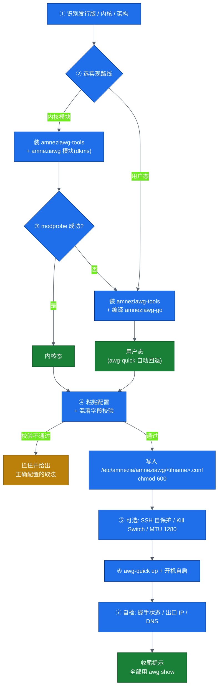

# amneziawg-install

**AmneziaWG 客户端一键安装脚本 · 跨发行版 · 内核模块编译不了就自动回退用户态**<br>
**One-shot AmneziaWG client installer for any Linux — falls back to userspace when the kernel module won't build**

> 姊妹项目 / Sister project: [NetApptool/wg-install](https://github.com/NetApptool/wg-install)（原生 WireGuard 客户端一键装）
> License: MIT · 不收集任何数据 · 脚本内零凭据

---

## 30 秒上手

```bash
curl -fsSL https://raw.githubusercontent.com/NetApptool/amneziawg-install/main/amneziawg-install.sh -o /tmp/awg-install.sh
sudo bash /tmp/awg-install.sh
# 粘贴你的 AmneziaWG 配置(必须带 Jc/Jmin/Jmax/S1/S2/H1-H4 混淆字段), 按 Ctrl+D 结束
```

无人值守 / 从文件读配置：

```bash
sudo bash /tmp/awg-install.sh --config /root/awg0.conf --yes --ifname awg0
```

只校验一份配置是否可用（不装任何东西，普通用户即可跑）：

```bash
bash amneziawg-install.sh --validate-config ./awg0.conf
```

---

## 为什么要单独做一个脚本

AmneziaWG 是 WireGuard 的抗审查分支（把报文类型码换成自定义 `H1-H4`、给报文加长度前缀 `S1-S4`、
握手前发 `Jc` 个垃圾包）。它**和原生 WireGuard 完全不互通**，安装也不是"装个 wireguard-tools"那么简单：

| 项目 | 原生 WireGuard | AmneziaWG |
|---|---|---|
| 命令行 | `wg` / `wg-quick` | **`awg`** / **`awg-quick`** |
| 配置目录 | `/etc/wireguard/` | **`/etc/amnezia/amneziawg/`**（源码硬编码，**没有环境变量能改**） |
| systemd 单元 | `wg-quick@wg0` | **`awg-quick@awg0`**（`PartOf=awg-quick.target`） |
| 状态查询 | `wg show` | **`awg show`** —— 用 `wg show` 永远是空的（genl 家族名/接口 kind 都叫 `amneziawg`） |
| 内核模块 | ≥5.6 内核内置 | **上游不内置**：dkms 编译，或用户态 `amneziawg-go` |
| 配置要求 | 标准 `[Interface]/[Peer]` | **必须带混淆字段**，否则跟服务端对不上 |

本脚本把上面这些差异全部吃掉，只留一条交互路径给你。

---

## 安装流程



---

## 支持的发行版与上游渠道

上游**没有**统一的包仓库，各发行版渠道差异很大（下表 2026-10-10 逐一核实）：

| 发行版 | 渠道 | 包名 | 脚本行为 |
|---|---|---|---|
| Ubuntu | PPA `ppa:amnezia/ppa` | `amneziawg-tools` / `amneziawg`(metapackage 含 dkms) | 自动加 PPA |
| Debian 12/13 | 上游无 Debian 代号 | 官方文档让写 `ubuntu focal` 源（有风险） | 先试官方文档路线，失败即源码编译 |
| RHEL / Rocky / Alma / CentOS Stream | COPR `amneziavpn/amneziawg` | `amneziawg-tools` / `amneziawg-dkms` | 自动 enable COPR（先补 EPEL） |
| **Fedora** | ⚠️ **官方 COPR 没有 fedora chroot** | — | 改用第三方 COPR `tigro/amneziawg`，并明确提示 |
| Arch / Manjaro | AUR | `amneziawg-tools` `amneziawg-dkms` `amneziawg-go` `amneziawg-linux` | 走 yay/paru |
| Alpine | 上游无 aports 包 | — | 直接源码编译 |
| openSUSE | 只有 `home:*` 个人仓库 | — | 直接源码编译 |
| 麒麟 V10 SP3 / openEuler | 未查到任何官方包，且内核 4.19 编不出模块 | — | 直接源码编译 + **用户态路线** |

任何发行版装不上包时都会自动回退到**源码编译**（`git clone` → `make && make install`，需要 gcc + make + git）。

---

## 两种实现路线

| | 内核模块（dkms） | 用户态（amneziawg-go） |
|---|---|---|
| 性能 | 高 | 低（"slow userspace implementation"——上游原话） |
| 依赖 | 内核头文件 + 完整内核源码树 | 只要 Go ≥ 1.25 和 git |
| 适用 | 常规发行版 | 信创 / 老内核 / 内核头文件拿不到 |
| 怎么起 | `awg-quick up awg0` 直接用上模块 | `awg-quick` 发现模块不可用 → **自动**调用 `amneziawg-go` |

回退是**上游 `awg-quick` 内建**的行为（`ip link add ... type amneziawg` 失败、
`/sys/module/amneziawg` 不存在、且 `amneziawg-go` 在 PATH 里 → 自动回退）。
本脚本的职责只是保证 `amneziawg-go` 装到位，并在收尾时**明确告诉你这次跑的是哪一种**。

---

## 混淆字段：为什么必须校验

服务端与客户端的这几个字段**必须一致**（上游口径）：

| 字段 | 类别 | 必须与服务端一致 | 说明 |
|---|---|---|---|
| `H1 H2 H3 H4` | 报文类型码 | ✅ | 可写单值或 `a-b` 区间；**区间不得互相重叠**（内核会 `-EINVAL`）；设为 `1/2/3/4` 即该位禁用 |
| `S1 S2` | 报文长度前缀 | ✅ | `len(init)=148+S1`、`len(resp)=92+S2`；**`S1+56` 不能等于 `S2`**，否则两种包等长无法区分 |
| `S3 S4` | cookie / 数据前缀 | ✅ | 新版本参数，很多现网配置不用 |
| `Jc Jmin Jmax` | 握手前垃圾包 | ❌ 客户端本地 | 缺了不影响连通，只少一层伪装；`Jmin < Jmax < 1280` |
| `I1-I5` `HeaderProtectionKey` 等 | AWG 3.x 新参数 | 视参数而定 | 只识别，不做判定 |

**最常见的坑**：GL.iNet 路由器的网页/二维码**默认按标准 WireGuard 生成配置，不带这些字段**。
照抄过来的配置能"存下来"但客户端读不了 / 连不上（现场实测表现为：发 148B 收 0B）。
本脚本会**直接拦住**这种配置并告诉你正确取法，而不是替你把字段瞎填上（瞎填的值跟服务端对不上，比不填更难查）。

用的越少越安全？不是——**混淆参数不一致 = 连不上**。所以脚本默认拦，不默认放行；
确实确认服务端没开混淆时，用 `--allow-incomplete` 显式放行。

---

## 命令行参数

```
-h, --help              显示帮助
-v, --version           显示版本
    --config FILE       从文件读配置(非交互); 缺省为交互粘贴 + Ctrl+D
    --ifname NAME       接口名, 默认 awg0(= 配置文件名 = systemd 单元实例名)
    --kernel            强制走内核模块(dkms)路线
    --userspace         强制走用户态 amneziawg-go 路线
    --yes, -y           所有交互取默认值(无人值守)
    --no-start          写入配置但不启动隧道、不开机自启
    --validate-config F 只校验配置合法性并退出(不装任何东西, 无需 root)
    --allow-incomplete  允许混淆字段不全的配置继续(不推荐)
```

脚本顺带处理的几件事：

- **SSH 自保护**：`AllowedIPs` 含 `0.0.0.0/0` 时，先给 SSH 对端加一条主机路由，避免隧道一起来 SSH 就断
- **DNS 自管**：把配置里的 `DNS =` 注释掉，改用 `PostUp/PostDown` 直接写 `/etc/resolv.conf`，
  不依赖 `systemd-resolved` / `openresolv` / `netconfig`（Rocky/RHEL/麒麟上这套经常失败）
- **MTU 提示**：全流量且未设 MTU 时建议写 `MTU = 1280`（经 4G/5G 拨入必须 ≤1280，否则能握手但打不开网页）
- **Kill Switch**（可选）：用 `awg show %i fwmark` 取 fwmark，不是 `wg show`
- **旧配置自动备份**：覆盖前存成 `awg0.conf.bak.<时间戳>`

---

## 装完以后

```bash
sudo awg show                 # 看状态 —— 不是 wg show!
sudo awg showconf awg0        # 看生效后的配置
sudo awg-quick down awg0      # 临时关
sudo awg-quick up awg0        # 临时开
sudo systemctl restart awg-quick@awg0
sudo systemctl disable --now awg-quick@awg0   # 永久禁用
```

配置文件在 `/etc/amnezia/amneziawg/awg0.conf`（权限 600）。改完要重启隧道才生效。

### 连不上时按顺序查

1. `sudo awg show` —— 有没有 `latest handshake`？
   - **没有握手**：`transfer` 是不是 `0 B received`？是的话服务端多半没登记本机公钥，或到 Endpoint 的 UDP 被挡
   - **有握手但打不开网页**：MTU 问题，试 `MTU = 1280`
2. **`wg show` 是空的 → 这是正常的**，AmneziaWG 只能用 `awg` 看
3. 混淆字段与服务端**逐字段对一遍**（尤其 `S1 S2 H1-H4`）
4. 内核态还是用户态？`ip -d link show awg0` 看 link kind

### 卸载

```bash
sudo systemctl disable --now awg-quick@awg0
sudo rm -f /etc/amnezia/amneziawg/awg0.conf /etc/amnezia/amneziawg/awg0-dns-*.sh
sudo rm -rf /etc/amnezia/amneziawg
# 工具与模块(视发行版)
sudo apt remove --purge amneziawg-tools amneziawg-dkms     # Debian/Ubuntu
sudo dnf remove amneziawg-tools amneziawg-dkms             # RHEL 系
sudo rm -f /usr/bin/awg /usr/bin/awg-quick                 # 源码编译装的
```

---

## 测试

```bash
bash tests/run-tests.sh        # 配置校验器回归测试(纯离线, 无需 root)
```

用例覆盖：完整配置通过、全流量+MTU 通过、标准 WG 配置被拦、GL.iNet 残缺配置被拦、
H 区间重叠被拦、数值越界/约束冲突被拦、缺客户端本地参数只提示、缺关键键被拦。

CI：`.github/workflows/shellcheck.yml`（`bash -n` + shellcheck，severity=warning 即失败）。

---

## English

A one-shot **AmneziaWG client** installer for any Linux distro. Paste your config, press Ctrl+D, done.

**Why not just install `wireguard-tools`?** AmneziaWG is wire-incompatible with WireGuard: the message-type
codes are replaced by `H1-H4`, packet lengths get prefixes `S1-S4`, and junk packets `Jc` are sent first.
So you need `awg`/`awg-quick` (not `wg`/`wg-quick`), configs live in `/etc/amnezia/amneziawg/`, the systemd
unit is `awg-quick@<ifname>`, `wg show` is always empty, and the kernel module is *not* in-tree —
it must be built via dkms or replaced by the userspace `amneziawg-go`.

**What this script does**

1. Detects distro/kernel/arch and picks an install route per-distro (PPA / COPR / AUR / source build).
2. Installs `amneziawg-tools`, then either the dkms kernel module or the userspace `amneziawg-go`
   (auto-falls back to userspace if the module won't build — the common case on hardened/legacy kernels).
3. **Validates your config**, hard-blocking the classic broken case: a plain WireGuard config exported
   from a GL.iNet router's web UI (no `Jc`/`S1`/`S2`/`H1-H4`) which simply cannot connect.
4. Optional SSH protection, kill switch, MTU 1280 for cellular links, DNS self-management.
5. Brings the tunnel up, enables `awg-quick@<ifname>` at boot, then self-checks handshake / egress IP / DNS.

The userspace fallback is built into upstream `awg-quick` itself (it calls `amneziawg-go` when
`ip link add ... type amneziawg` fails); this script just makes sure `amneziawg-go` is there and tells
you which implementation actually ended up in use.

---

## 致谢 / Credits

- 上游项目：[amnezia-vpn/amneziawg-tools](https://github.com/amnezia-vpn/amneziawg-tools) ·
  [amneziawg-go](https://github.com/amnezia-vpn/amneziawg-go) ·
  [amneziawg-linux-kernel-module](https://github.com/amnezia-vpn/amneziawg-linux-kernel-module)
- 参数语义与约束来源：[AmneziaWG 官方文档](https://docs.amnezia.org/documentation/amnezia-wg/)
- 脚本结构参考同作者的 [wg-install](https://github.com/NetApptool/wg-install)

本脚本与 Amnezia 官方无隶属关系，仅为社区便利工具。MIT License。
